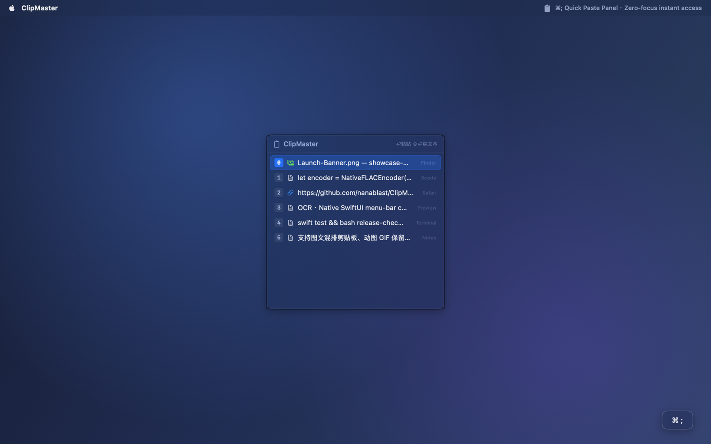
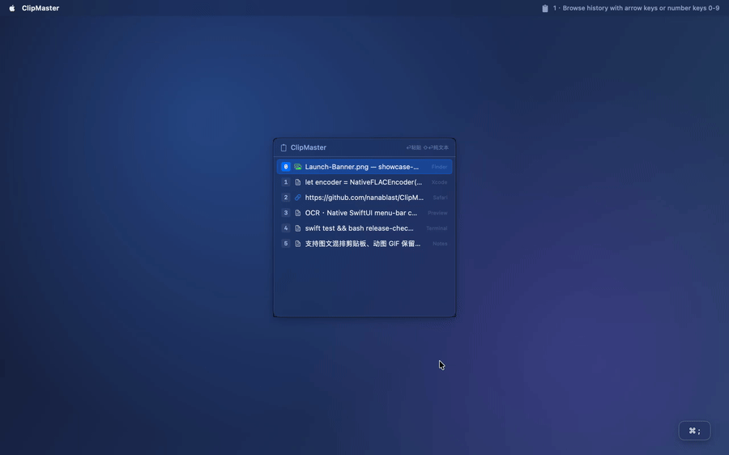
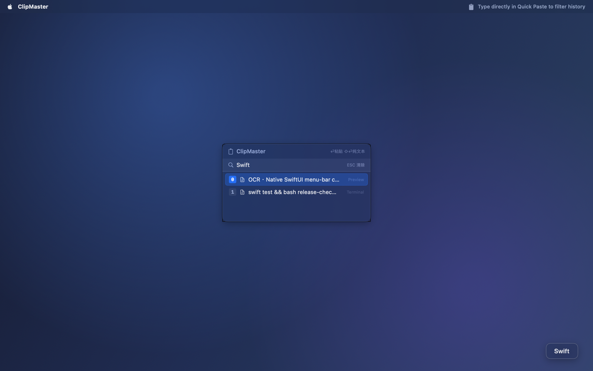
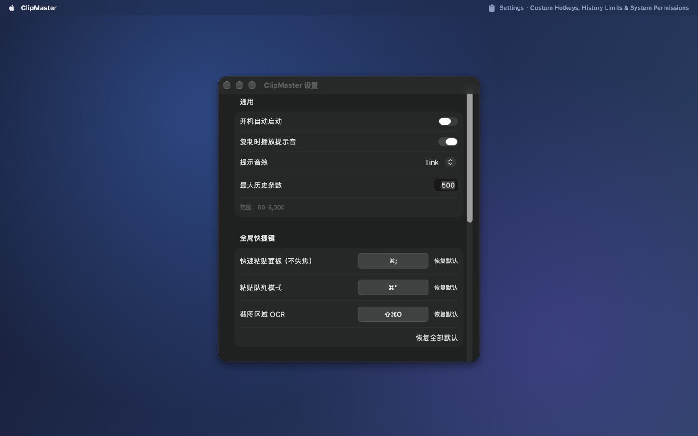

<div align="center">

# ClipMaster

**A fast, lightweight native macOS menu-bar clipboard manager built with Swift & SwiftUI.**

[](https://www.apple.com/macos/)
[](https://swift.org/)
[](LICENSE)

English | [简体中文](README.zh-CN.md)

<br />



</div>

---

## Live Demo

<div align="center">
  
  <br />
  <sub>
    Prefer full resolution? <a href="docs/media/demo.mp4">Watch full 1280×800 H.264 video (demo.mp4)</a>
  </sub>
</div>

---

## Features

- **Zero-Focus Quick Paste (`⌘;`)**: Non-activating `NSPanel` floats right over your current editor without ever stealing keyboard focus. Browse and paste back to the previous app seamlessly.
- **Type-to-Search Filtering**: Start typing immediately inside Quick Paste to filter history in real time by content or source app, with `ESC` to clear.
- **Paste Queue Mode (`⌘'`)**: Queue copied snippets sequentially (capped at 64 items / 64 MiB) and paste them in FIFO order one after another.
- **Screenshot Region OCR (`⌘⇧O`)**: Drag to capture any screen region and extract text via multi-pass Apple Vision OCR (CJK, Japanese, and English) directly to the clipboard and history.
- **Rich Formats, Persistent Images & GIF Preservation**: Tracks text, links, files, and images; stores persistent image assets on disk (up to 100 items / 300 MB) and preserves animated GIF frames as well as dual-format paste replay.
- **Menu Bar Minimalist UI & Low Idle Overhead**: Runs with `LSUIElement=true` (no Dock icon), adaptive polling (`200ms` active / `1s` idle), configurable sound feedback, customizable hotkeys, and **50–5,000** persisted SQLite history items.

---

## Screenshots

<table>
  <tr>
    <td align="center" width="50%">
      
      <br />
      <sub><strong>Instant Keyboard Filtering</strong> — Start typing inside the Quick Paste panel to narrow down snippets immediately.</sub>
    </td>
    <td align="center" width="50%">
      
      <br />
      <sub><strong>Preferences & Global Shortcuts</strong> — Customize global hotkeys, history retention limits, launch at login, and permissions.</sub>
    </td>
  </tr>
</table>

---

## Keyboard Shortcuts

| Shortcut | Action |
|---|---|
| `⌘;` | Toggle Quick Paste floating panel (zero-focus) |
| `⌘'` | Toggle FIFO Paste Queue mode (up to 64 items / 64 MiB) |
| `⌘⇧O` | Trigger Screenshot Region OCR |
| `⏎` | Paste selected item (pastes image data for image items) |
| `⇧⏎` | Paste as plain text / OCR extracted text |
| `0` – `9` | Instant select & paste item by visible index |
| `⌘⌫` | Delete selected item from history |
| Type characters directly | Filter clipboard history live inside `⌘;` Quick Paste |

---

## Build, Test & Deploy

### Requirements
- macOS 13.0+ (Ventura or later)
- Swift 5.9+ toolchain (SPM dependencies: `GRDB.swift` 6.24+, `HotKey` 0.2+, `LaunchAtLogin-Modern` 1.1+)

### Commands

```bash
# Run unit tests
swift test

# Debug build
swift build

# Release build + .app bundle packaging
bash build.sh

# Build & deploy locally (resets Accessibility TCC permission cleanly)
bash deploy.sh

# All-in-one: test + release build + deploy
bash release-check.sh
```

### Permissions & Gatekeeper Troubleshooting

ClipMaster uses Accessibility to replay `⌘V` and Screen Recording for `⌘⇧O` Screenshot OCR. If a re-signed build triggers stale macOS TCC state:

```bash
tccutil reset Accessibility com.clipmaster.app
tccutil reset ScreenCapture com.clipmaster.app
```

If launching an unsigned local build triggers macOS Gatekeeper quarantine:

```bash
xattr -dr com.apple.quarantine /Applications/ClipMaster.app
```

> **Storage & Logs:**
> - SQLite database: `~/Library/Application Support/ClipMaster/ClipMaster.sqlite`
> - Debug logs: `~/Library/Application Support/ClipMaster/debug.log`

---

## Project Links

- [CHANGELOG](CHANGELOG.md)
- [Contributing Guide](CONTRIBUTING.md)
- [Code of Conduct](CODE_OF_CONDUCT.md)
- [MIT License](LICENSE)
