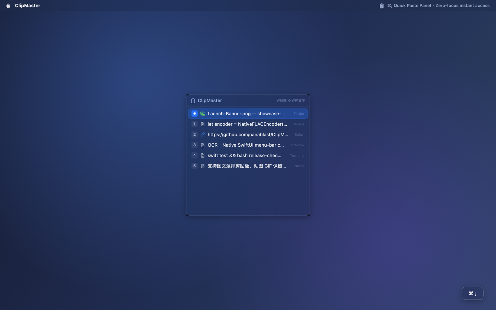
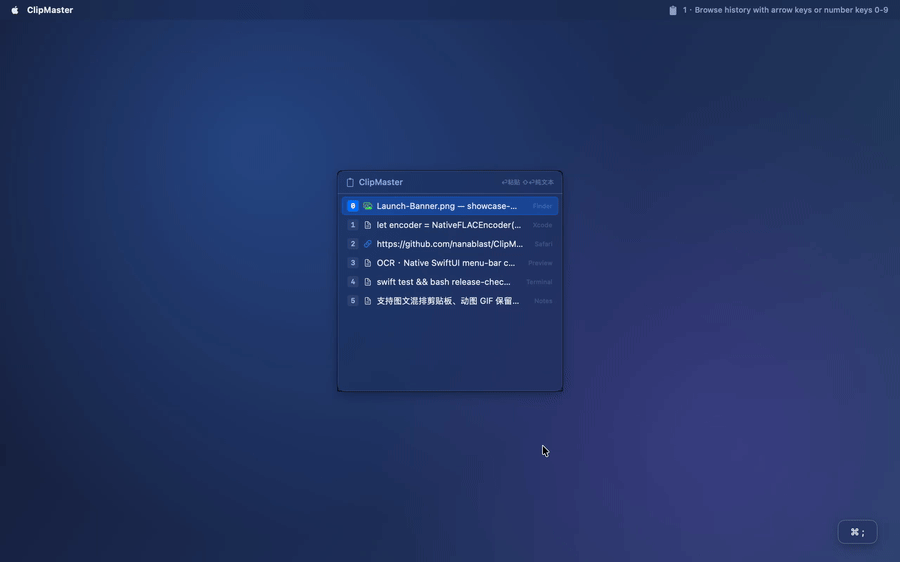
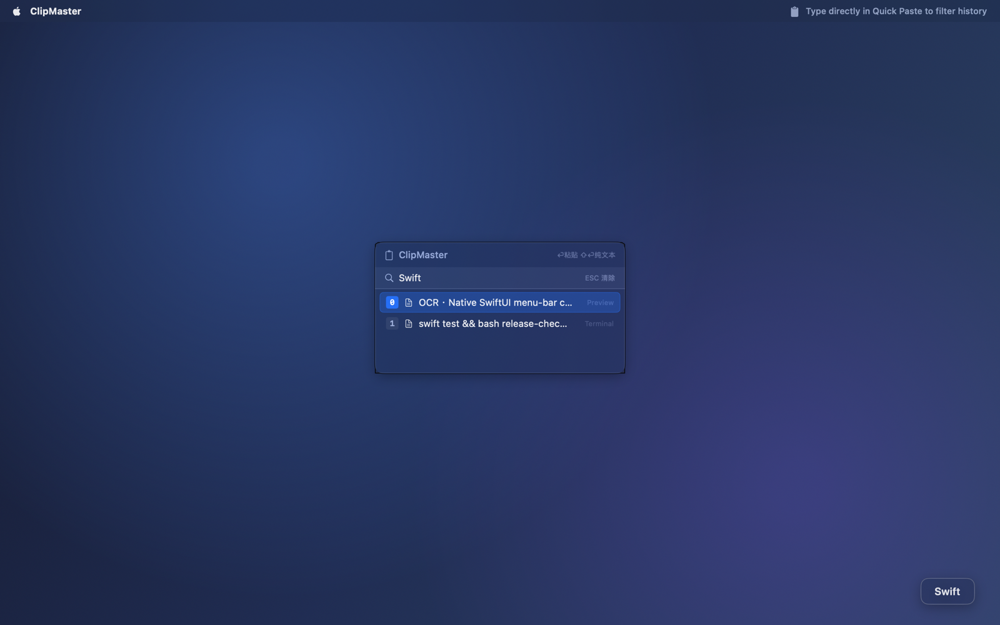
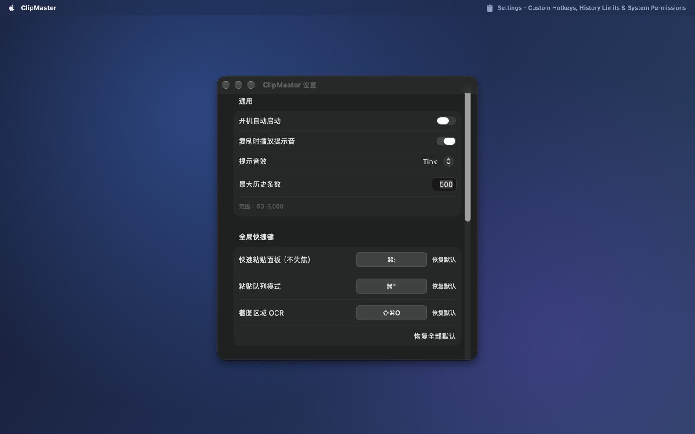

<div align="center">

# ClipMaster

**轻量、高速的 macOS 原生菜单栏剪贴板管理器（Swift + SwiftUI + SQLite）。**

[](https://www.apple.com/macos/)
[](https://swift.org/)
[](LICENSE)

[English](README.md) | 简体中文

<br />



</div>

---

## 动态演示

<div align="center">
  
  <br />
  <sub>
    需要更清晰画质？<a href="docs/media/demo.mp4">观看 1280×800 H.264 完整视频 (demo.mp4)</a>
  </sub>
</div>

---

## 核心特性

- **不抢焦点的快速粘贴面板（`⌘;`）**：基于非激活 `NSPanel` 实现，呼出时不切换当前应用焦点，选定后直接回贴到原窗口光标处。
- **直接打字实时搜索**：面板内无需点搜索框，直接键入关键词即可按内容或来源应用实时过滤，按 `ESC` 清除搜索词。
- **顺序粘贴队列模式（`⌘'`）**：连续复制多条片段进入先进先出（FIFO）队列（最多 64 条 / 64 MiB），按序逐条粘贴。
- **截图区域 OCR 识别（`⌘⇧O`）**：框选屏幕任意区域，内置多轮 Apple Vision 中日英混合文字识别，自动提取文字并写入剪贴板历史。
- **丰富格式支持、持久化图片与动图保留**：记录文本、链接、文件及图片；本地持久化缓存图片资源（上限 100 张 / 300 MB），保留 GIF 动图帧数据与双格式粘贴回放能力。
- **极简菜单栏常驻与自适应省电**：以 `LSUIElement=true` 纯菜单栏后台运行，支持自适应轮询（活跃 `200ms` / 空闲 `1s`）、可选提示音、自定义全局快捷键以及 **50–5,000** 条 SQLite 历史保留上限。

---

## 界面截图

<table>
  <tr>
    <td align="center" width="50%">
      
      <br />
      <sub><strong>即打即搜过滤</strong> — 在快速粘贴面板内直接输入字符即可秒级缩小匹配结果。</sub>
    </td>
    <td align="center" width="50%">
      
      <br />
      <sub><strong>全局快捷键与偏好设置</strong> — 自定义呼出快捷键、历史条数上限、开机启动与系统权限状态。</sub>
    </td>
  </tr>
</table>

---

## 快捷键一览

| 快捷键 | 功能说明 |
|---|---|
| `⌘;` | 呼出 / 关闭快速粘贴面板（不失焦） |
| `⌘'` | 开启 / 关闭粘贴队列模式（最多 64 条 / 64 MiB） |
| `⌘⇧O` | 框选屏幕区域进行截图 OCR 识别 |
| `⏎` | 粘贴选中项（图片类型按图片粘贴） |
| `⇧⏎` | 粘贴为纯文本 / OCR 提取文本 |
| `0` – `9` | 按数字编号快速选择并粘贴 |
| `⌘⌫` | 删除当前选中历史记录 |
| 直接打字 | 在 `⌘;` 面板中实时搜索过滤历史记录 |

---

## 构建、测试与部署

### 环境要求
- macOS 13.0+（Ventura 或更高版本）
- Swift 5.9+ 工具链（核心依赖：`GRDB.swift` 6.24+、`HotKey` 0.2+、`LaunchAtLogin-Modern` 1.1+）

### 常用命令

```bash
# 运行全部单元测试
swift test

# Debug 构建
swift build

# Release 构建并打包 .app
bash build.sh

# 构建并部署到本地（部署前会重置辅助功能 TCC 授权）
bash deploy.sh

# 一键执行：测试 + Release 构建 + 部署
bash release-check.sh
```

### 系统权限与 Gatekeeper 处理

ClipMaster 需要 **辅助功能** 权限模拟 `⌘V` 粘贴，以及 **录屏与系统录音** 权限支持 `⌘⇧O` 截图 OCR。若本地重新编译签名后系统未自动更新授权状态，可执行以下命令重置：

```bash
tccutil reset Accessibility com.clipmaster.app
tccutil reset ScreenCapture com.clipmaster.app
```

如果系统提示“已损坏”或拦截未签名构建，可移除隔离属性后打开：

```bash
xattr -dr com.apple.quarantine /Applications/ClipMaster.app
```

> **数据与日志路径：**
> - SQLite 数据库：`~/Library/Application Support/ClipMaster/ClipMaster.sqlite`
> - 调试日志：`~/Library/Application Support/ClipMaster/debug.log`

---

## 相关文档

- [更新日志 (CHANGELOG)](CHANGELOG.md)
- [参与贡献 (CONTRIBUTING)](CONTRIBUTING.md)
- [行为准则 (CODE_OF_CONDUCT)](CODE_OF_CONDUCT.md)
- [开源协议 (MIT LICENSE)](LICENSE)
